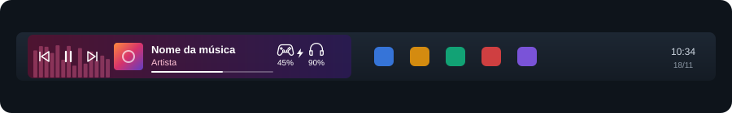

<p align="center"></p>
<h1 align="center">MiniPlayer</h1>
<p align="center">Mini player de mídia para a barra de tarefas do Windows 10/11 — com espectro de áudio, volume na rolagem do mouse e a bateria dos seus fones, controles, mouses e teclados.</p>
<p align="center"><a href="../../releases/latest"><b>⬇ Baixar a versão mais recente</b></a></p>

<p align="center"></p>

> As imagens desta página são ilustrações do layout do app.

## Download
Em [Releases](../../releases/latest) há duas opções:

| Arquivo | Para quem |
|---|---|
| **MiniPlayer-Setup.exe** *(recomendado)* | Instala só para o seu usuário (sem pedir administrador), cria atalho no menu Iniciar e já deixa "Iniciar com o Windows" ativado. Atualizar = baixar e instalar a versão nova por cima. |
| **MiniPlayer.exe** *(portátil)* | Não instala nada: é só abrir, de qualquer pasta. |

> Na primeira execução o Windows SmartScreen pode avisar sobre "editor desconhecido": clique em **Mais informações → Executar assim mesmo**.

## O que ele faz

### 🎵 Mídia
- **Controla qualquer player**: voltar, play/pause e avançar, com capa, título e artista do que estiver tocando (Spotify, Tidal, YouTube e outros sites no navegador, players de vídeo…).
- **Barra de progresso** abaixo do título — clique nela para avançar ou voltar.
- **Título longo rola** ao passar o mouse sobre ele.
- **Volume na rolagem do mouse**: role sobre o player para mudar o volume do app que está tocando. Passe o mouse na capa para ver o volume atual.
- **Várias mídias abertas?** O player mostra a que está tocando com som. O botão **⇄** (aparece só quando há mais de uma) alterna manualmente.
- **Prévias do YouTube** ao passar o mouse nas miniaturas são ignoradas.
- **Streamings sem capa** (Netflix, Prime Video, Disney+…) ganham uma imagem padrão; sem nenhuma informação, aparece uma nota musical.
- **Espectro de áudio** discreto atrás dos botões, na cor da capa.

### 🔋 Bateria dos dispositivos
Em tempo real, com ícone por tipo e um ⚡ quando está carregando. Passe o mouse sobre um dispositivo para ver o nome e o **tempo restante estimado**.
- Tudo que o Windows informa via Bluetooth: fones, caixas de som, controles Xbox, teclados, mouses…
- DualSense e DualShock 4 (Bluetooth ou cabo), lidos direto do controle.
- Logitech (Lightspeed, Unifying e Bolt), Razer sem fio, Nintendo Pro Controller e Joy-Con.
- Mouses e teclados 2.4 GHz que seguem o padrão HID de bateria.
- Aparelhos que não informam bateria aparecem com **--**.

### 🖥️ Na tela
- **Encaixe automático** na barra de tarefas, em todos os monitores — inclusive com a **barra na lateral**:

<p align="center"></p>

- **Solto na tela**: arraste para onde quiser, na horizontal ou na vertical, acima ou atrás das janelas — e trave a posição se quiser.
- **Some sozinho** em jogos e vídeos em tela cheia.
- **Nítido** em qualquer escala do Windows (125%, 150%, 200%…).
- **Leve**: só faz trabalho quando algo muda.

### 🎨 Temas
11 temas com degradê, incluindo o **Dinâmico**, que acompanha as cores da capa que está tocando:

<p align="center"></p>

## Menu
Clique com o botão direito no player — ou no ícone do MiniPlayer na bandeja do sistema, perto do relógio (se não aparecer, procure na seta **^**). Os dois menus têm as mesmas opções.

| Menu | Opção | O que faz |
|---|---|---|
| **Posição** | Fixo na barra de tarefas | Encaixa o player na barra (padrão). |
| | Solto na tela (arrastar) | Desprende o player: arraste-o para onde quiser. A posição é lembrada e ele sempre fica inteiro dentro de um monitor. |
| | Layout vertical (solto) | ✓ = player solto em coluna. |
| | Travar posição (solto) | ✓ = não pode ser arrastado e sempre abre no mesmo lugar (útil com outros apps de barra de tarefas). |
| | Atrás das janelas (solto) | ✓ = fica atrás das janelas, como um widget da área de trabalho. Sobre a barra de tarefas e no **Win+D** continua visível. |
| **Exibir** | Controles de mídia | ✓ = mostra botões, capa, título e espectro. |
| | Bateria dos dispositivos | ✓ = mostra os indicadores de bateria. Um dos dois sempre fica visível. |
| **Tema** | 11 opções | Padrão, Escuro, Claro, Neon, Pôr do sol, Oceano, Floresta, Púrpura, Rubi, Alto contraste e Dinâmico. |
| **Tamanho** | Pequeno / Médio / Grande | Tamanho do player. |
| | Iniciar com o Windows | ✓ = abre o MiniPlayer ao ligar o PC. |
| | Encerrar MiniPlayer | Fecha o app. |

**✓ significa ativado**; em Posição, Tema e Tamanho, o ✓ indica a opção atual. O menu segue o idioma do Windows (português, inglês, espanhol, francês ou alemão; outros idiomas usam inglês).

## Onde ele fica na barra
O encaixe segue o alinhamento da barra do Windows (*Configurações → Personalização → Barra de tarefas → Comportamentos → Alinhamento*):
- **Centralizado**: um player em cada monitor, no canto esquerdo da barra.
- **À esquerda**: colado à esquerda da bandeja/relógio, em cada monitor.
- **Barra na lateral** (esquerda/direita, via ExplorerPatcher, StartAllBack etc.): coluna compacta no topo da barra ou acima da bandeja.

Mudou o alinhamento ou a posição da barra? O player se ajusta sozinho.

## Dúvidas comuns
- **O player mostra o vídeo em que passei o mouse no YouTube.** O app já ignora prévias sem som. Para eliminar de vez: no YouTube, foto de perfil → **Configurações → Reprodução e desempenho** → desmarque **Reprodução inline**.
- **A bateria do meu aparelho aparece com "--".** O próprio aparelho não informa a bateria ao Windows. Mouses/teclados com dongle de protocolo próprio também podem não informar.
- **A % do controle muda de 10 em 10.** Alguns aparelhos só informam a bateria em faixas (o DualSense informa 11 níveis); o app mostra a precisão que o aparelho entrega.
- **O volume da rolagem muda o volume geral, não o do app.** Acontece quando o app não aparece no mixer de volume do Windows com um nome reconhecível (ex.: Firefox).
- **"Iniciar com o Windows" não funcionou.** Ele usa a lista de inicialização do Windows (Gerenciador de Tarefas › Aplicativos de inicialização) — confira se não está desativado lá. Se moveu o exe portátil de pasta, abra-o uma vez para o caminho ser atualizado.

## Privacidade
O MiniPlayer **não envia nada para a internet** e não coleta dados. Título, capa, áudio (para o espectro) e informações de bateria são lidos e usados só na memória do seu PC, na hora. As únicas coisas salvas são suas preferências, em `%AppData%\MiniPlayer.txt`.

## Compilar o código
Requer o .NET 8 SDK. Rode `Compilar.bat` ou:
```
dotnet publish -c Release -r win-x64 --self-contained true -p:PublishSingleFile=true
```
O instalador é gerado com [Inno Setup](https://jrsoftware.org/isinfo.php) a partir de `installer.iss`.
