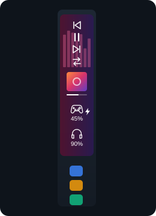
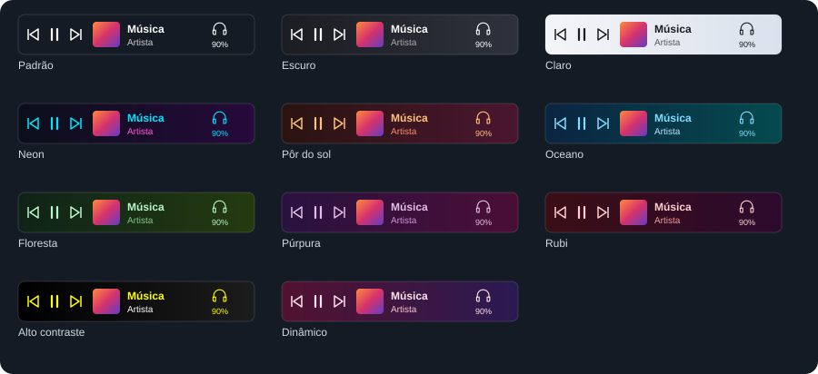

<p align="center"></p>
<h1 align="center">MiniPlayer</h1>
<p align="center"><b>English</b> · <a href="README.pt-BR.md">Português</a></p>
<p align="center">A tiny media player for the Windows 10/11 taskbar — with an audio spectrum, scroll-wheel volume, the battery of your headphones, controllers, mice and keyboards, and a compact system monitor.</p>
<p align="center"><a href="../../releases/latest"><b>⬇ Download the latest version</b></a></p>

<p align="center"></p>

> The images on this page are illustrations of the app's layout.

## Download
[Releases](../../releases/latest) has two options:

| File | For |
|---|---|
| **MiniPlayer-Setup.exe** *(recommended)* | Installs for your user only (no admin rights), adds a Start menu shortcut and turns on "Start with Windows". To update, just install the new version over it. |
| **MiniPlayer.exe** *(portable)* | Nothing to install: just run it from any folder. |

> On first run, Windows SmartScreen may warn about an "unknown publisher": click **More info → Run anyway**.

## Features

### 🎵 Media
- **Controls any player**: previous, play/pause and next, with the cover, title and artist of what's playing (Spotify, Tidal, YouTube and other sites in the browser, video players…).
- **Progress bar** under the title — click it to seek.
- **Long titles scroll** when you hover over them.
- **Scroll-wheel volume**: scroll over the cover or the buttons to change the volume of the app that's playing. Hover the cover to see the current volume.
- **Several media open?** The player shows the one actually playing sound. To switch manually, scroll over the title or click the **⇅** button (only shown when there's more than one) — the media rolls up/down with a short animation.
- **YouTube hover previews** are ignored.
- **Streaming services without a cover** (Netflix, Prime Video, Disney+…) get a default image; with no info at all, a music note is shown.
- **Subtle audio spectrum** behind the buttons, in the cover's color.

### 🔋 Device battery
Real time, with an icon per device type and a ⚡ while charging. Hover a device to see its name and the **estimated time left**; click it to open the Windows Bluetooth settings.
- Everything Windows reports over Bluetooth: headphones, speakers, Xbox controllers, keyboards, mice…
- DualSense and DualShock 4 (Bluetooth or cable), read directly from the controller.
- Logitech (Lightspeed, Unifying and Bolt), Razer wireless, Nintendo Pro Controller and Joy-Con.
- 2.4 GHz mice and keyboards that follow the HID battery standard.
- Devices that don't report a battery show **--**.

### 📊 System monitor
Pick the items you want: **RAM, CPU, CPU temperature, GPU, GPU temperature, network speed** (with a Wi-Fi or cable icon) and **ping**.
- Shows 3 items at a time — **scroll the mouse** over them (or click the arrows) to see the rest, or turn on automatic scrolling. Or turn the limit off to show them all at once.
- **Drag** an item to change the order. **Click** to open Task Manager.
- Values turn orange when high (usage ≥ 90%, temperature ≥ 85 °C, ping ≥ 150 ms).
- Works on any hardware, without admin rights or drivers. CPU temperature depends on the motherboard reporting it to Windows.

### 🖥️ On screen
- **Fits the free space** on the taskbar, on every monitor — without covering taskbar icons. If space is short, it shrinks step by step (fewer monitor items, then no title, then no cover). Also works with the taskbar **on the side**:

<p align="center"></p>

- **Floating**: drag it anywhere, horizontal or vertical, above or behind windows — and lock its position if you want.
- **Hides itself** during full-screen games and videos.
- **Sharp** at any Windows scale (125%, 150%, 200%…).
- **Lightweight**: only works when something changes.

### 🎨 Themes
11 themes with gradients, including **Dynamic**, which follows the colors of the current cover:

<p align="center"></p>

## Menu
Right-click the player — or the MiniPlayer icon in the system tray, near the clock (if it isn't there, look under the **^** arrow). Both menus have the same options.

| Option | What it does |
|---|---|
| **Docked to the taskbar** | ✓ = fixed on the taskbar (default). Unchecked = floating: drag it anywhere; it always stays fully inside one monitor. |
| **Lock position** | ✓ = the floating player can't be dragged (useful with other taskbar apps). Floating only. |
| **Position (Floating)** | Vertical or horizontal layout, and **Behind windows** (works like a desktop widget; still visible over the taskbar and with **Win+D**). Floating only. |
| **Show** | Media controls, device battery and system monitor (with its items and automatic scrolling). One group always stays visible. |
| **Theme** | Default, Dark, Light, Neon, Sunset, Ocean, Forest, Purple, Ruby, High contrast and Dynamic. |
| **Language** | Automatic (follows Windows) or Português, English, Español, Français, Deutsch. |
| **Size** | Small / Medium / Large. |
| **Start with Windows** | ✓ = opens MiniPlayer when the PC starts. |
| **Exit MiniPlayer** | Closes the app. |

## Where it sits on the taskbar
It follows the Windows taskbar alignment (*Settings → Personalization → Taskbar → Taskbar behaviors → Alignment*):
- **Center**: one player per monitor, on the left side of the taskbar (after the Widgets button).
- **Left**: next to the tray/clock, on every monitor.
- **Side taskbar** (left/right, via ExplorerPatcher, StartAllBack etc.): compact column at the top or above the tray.

Changed the alignment or taskbar position? The player adjusts by itself.

## FAQ
- **The player shows the video I hovered on YouTube.** The app already ignores silent previews. To get rid of it completely: on YouTube, profile picture → **Settings → Playback and performance** → turn off **Inline playback**.
- **My device's battery shows "--".** The device itself doesn't report its battery to Windows. Mice/keyboards with proprietary dongles may not report it either.
- **The controller % changes in steps of 10.** Some devices only report battery in ranges (the DualSense reports 11 levels); the app shows the precision the device provides.
- **Scrolling changes the master volume, not the app's.** This happens when the app doesn't appear in the Windows volume mixer with a recognizable name (e.g. Firefox).
- **"Start with Windows" didn't work.** It uses the Windows startup list (Task Manager › Startup apps) — check it isn't disabled there. If you moved the portable exe, run it once so the path gets updated.

## Privacy
MiniPlayer **doesn't collect any data** and has no account, telemetry or ads. Title, cover, audio (for the spectrum), battery and system information are read and used only in your PC's memory, on the spot. The only thing saved is your preferences, in `%AppData%\MiniPlayer.txt`.
The only network traffic is the optional **Ping** item: while it's on, it sends one tiny packet (16 bytes) every 2 seconds to 1.1.1.1 (Cloudflare) or 8.8.8.8 (Google) to measure latency. Network speed only reads Windows' own counters and sends nothing.

## Building
Requires the .NET 8 SDK. Run `Compilar.bat` or:
```
dotnet publish -c Release -r win-x64 --self-contained true -p:PublishSingleFile=true
```
The installer is built with [Inno Setup](https://jrsoftware.org/isinfo.php) from `installer.iss`.
